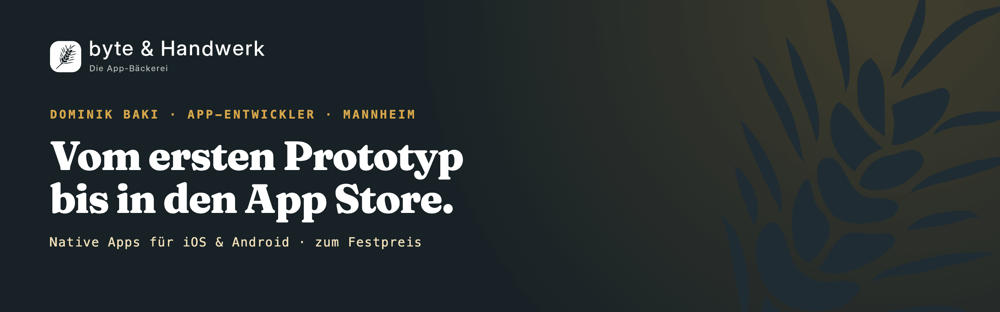

  

## Hallo, ich bin Dominik

Gelernter Bäcker, heute App-Entwickler in Mannheim und Gründer von [byte & Handwerk](https://byteundhandwerk.de).

Ich entwickle native Apps für iOS und Android, in sechs Paketen mit Festpreis, vom ersten Prototyp bis in den App Store. Dabei verbinde ich Erfahrung aus Handwerk, regulierter Produktion und Vertrieb mit nutzerzentrierter Produktentwicklung.

**Problem vor Technologie · Klarheit vor Funktionsumfang · Pilotprojekt vor Großprojekt · Belege vor Behauptungen**

## Projekte

| Projekt | Worum es geht | Stand |
| --- | --- | --- |
| **RevierHege** | Native App für kleine Jagdgemeinschaften, auf iOS und Android. Entwickelt mit einer realen Pilotgruppe, Kartenansicht, Rollenmodell und fortlaufenden Feedbackschleifen. | Beta: iOS über TestFlight, Android als geschlossener Test bei Google Play · [Fallstudie](https://byteundhandwerk.de/referenz-revierhege) |
| **[TreueBiss](https://github.com/byte-und-handwerk/TreueBiss)** | White-Label-Lösung für digitale Kundenbindung im Lebensmittelhandwerk mit einfacher Stempel- und Gutscheinlogik. | Wird überarbeitet · [Stand](https://byteundhandwerk.de/treuebiss) |
| **[EmigrateIn](https://github.com/Code-Noob82/EmigrateIn)** | iOS-MVP zur strukturierten Unterstützung von Familien bei der Vorbereitung einer Auswanderung. | Abschlussprojekt, ruht derzeit · [Fallstudie](https://byteundhandwerk.de/referenz-emigratein) |

## Technik

- **Native Apps:** Swift, SwiftUI, SwiftData, MapKit, Kotlin, Jetpack Compose, Material 3, Maps Compose, Room, Hilt und Coroutines
- **Backend & Daten:** Firebase (Authentication, Firestore, Cloud Messaging, Cloud Functions, Emulator Suite), Supabase, REST-Schnittstellen, SQL
- **Architektur & Qualität:** MVVM, Clean Architecture, Repository Pattern, Dependency Injection, Unit-Tests mit JUnit, XCTest und Swift Testing, UI-Tests mit Compose UI Test und XCUITest
- **Produkt & Auslieferung:** Figma, GitHub Actions, TestFlight, Google Play Console, KI-Werkzeuge (Claude Code, ChatGPT mit Codex, Gemini, DeutschlandGPT)

## Qualifikationen

- **IT-Fachkraft für App-Entwicklung (iOS & Android)**, Syntax Institut, 09/2024–09/2025, 2.300 Unterrichtseinheiten
- **iOS App Developer (IHK)**, IHK Akademie München und Oberbayern, 06/2025
- **Android App Developer (IHK)**, IHK Akademie München und Oberbayern, 10/2025
- **Staatlich geprüfter biotechnologischer Assistent**, Berufskolleg Biotechnologie, Johannes-Gutenberg-Schule Heidelberg
- **Gesellenprüfung als Bäcker**, Handwerkskammer Mannheim, 2001

## Kontakt

- Profil: [dominikbaki.com](https://dominikbaki.com)
- Unternehmen: [byteundhandwerk.de](https://byteundhandwerk.de)
- LinkedIn: [Dominik Baki](https://www.linkedin.com/in/dominik-baki)
- E-Mail: dominik.baki@byteundhandwerk.de
